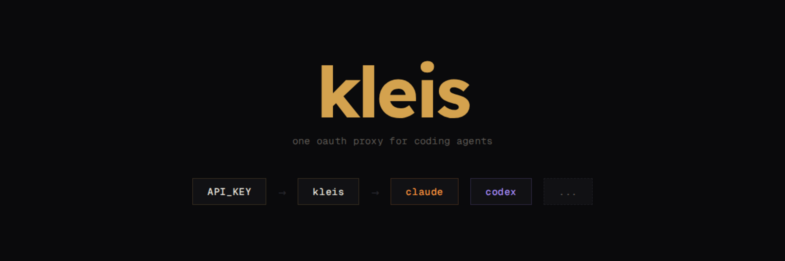
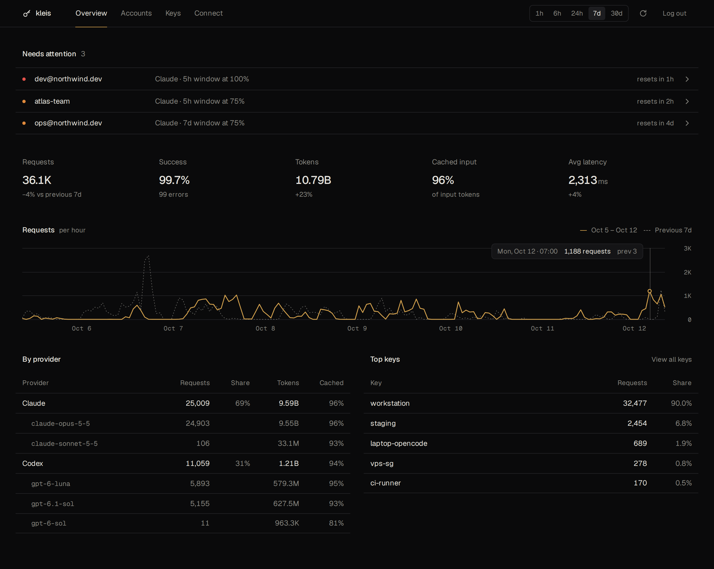
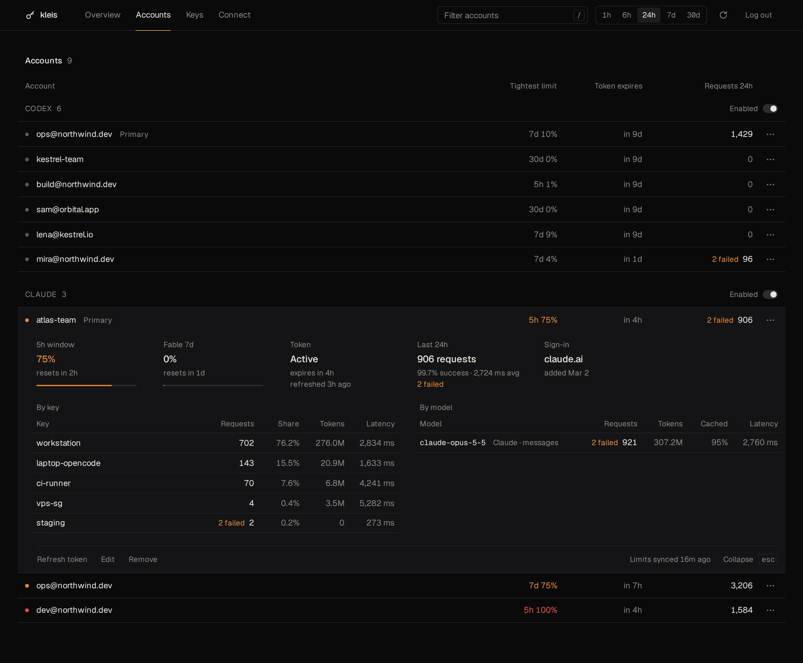
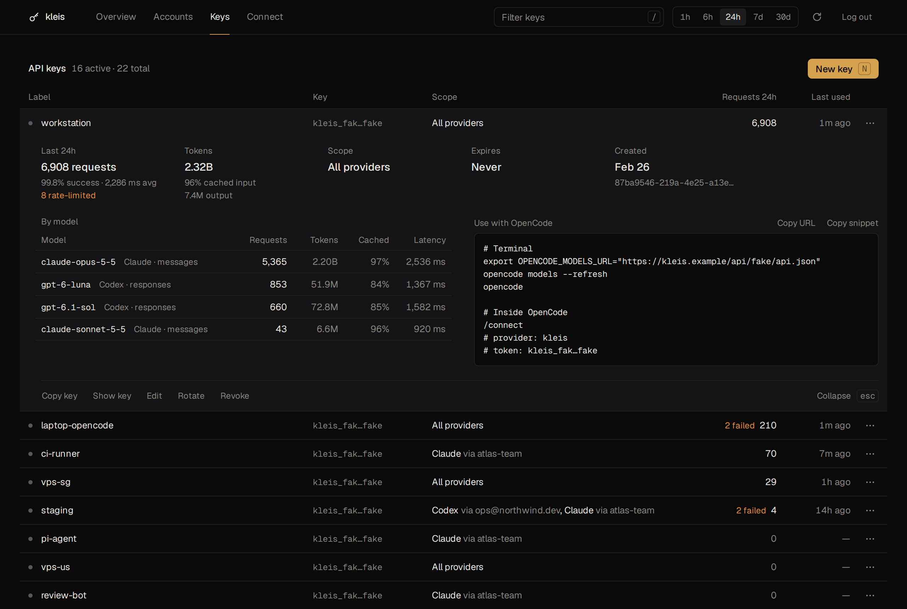
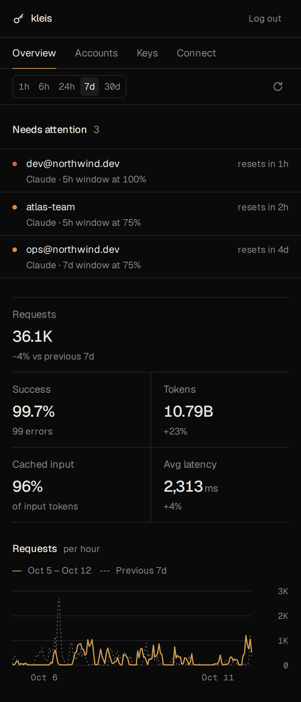

<p align="center">
  
</p>

OAuth account proxy for [OpenCode](https://github.com/anomalyco/opencode). One base URL for Codex and Claude.

> [!NOTE]
> "Kleis" is named from the idea of a key that can unlock many paths with one handle.

Re-authenticating OAuth accounts across clients and machines is painful. Kleis stores credentials centrally, refreshes tokens automatically, and lets clients authenticate with simple API keys.

---

## How it works

Each provider has its own proxy adapter because none of them behave the same way. Codex rejects certain params and requires instruction injection. Claude needs tool name prefixing, system identity rewriting, beta header merging, and streaming response transformation to strip those prefixes back out.

`GET /api.json` serves a models.dev-compatible registry that merges upstream model data with Kleis routing info, so OpenCode auto-discovers everything without manual model config.

Each API key also gets a scoped discovery URL at `GET /api/<models-discovery-token>/api.json`, so model discovery can match that key's provider/model scopes.

There's also minute-bucketed request analytics across both API keys and provider accounts (non-blocking on the proxy path), and a small admin panel for managing accounts, keys, and token refreshes.

### Proxy routes

| Route | Provider | Endpoint |
|---|---|---|
| `POST /openai/v1/responses` | Codex | Responses API |
| `POST /anthropic/v1/messages` | Claude | Messages API |

---

## Admin panel

Usage, rate limits, and token health for every account and key.

<p align="center">
  
</p>

<details>
<summary>Accounts, keys, and phone layout</summary>
<br />
<p align="center">
  
</p>
<p align="center">
  
</p>
<p align="center">
  
</p>
</details>

---

## Setup

```sh
bun install
```

Create `.env`:

```env
ADMIN_TOKEN=replace-with-a-long-random-token
CRON_SECRET=replace-with-a-long-random-token
TURSO_CONNECTION_URL=libsql://<your-db>.<region>.turso.io
TURSO_AUTH_TOKEN=<your-turso-token>
```

Codex uses HTTP/SSE by default. The lower-latency WebSocket transport is
experimental and can be enabled with `CODEX_WEBSOCKET_ENABLED=true`.

```sh
bun run db:migrate
bun run dev
```

Admin panel lives at `http://localhost:3003/admin/`.

---

## OAuth flows

- Codex: browser callback code flow or headless device flow.
- Claude: authorization code flow (`claude.ai` or `console.anthropic.com` mode).

After connecting accounts, set one primary account per provider.

If a Codex or Claude login needs repair, select **reauthorize** on that account
in the admin panel. Complete the OAuth flow to replace its credentials while
keeping its account ID, primary setting, and API-key account scopes. Starting
a new OAuth flow from the Connect tab creates a separate account when the
provider does not return a stable account identifier.

---

## OpenCode configuration

After creating an API key in the admin panel:

```env
OPENCODE_MODELS_URL=https://your-kleis-domain/api/<models-discovery-token>
KLEIS_API_KEY=your-issued-key
```

---

## Self-hosted deploys

Pushes to `main` build an image and run `scripts/deploy-release.sh` on the host
over SSH. Releases alternate between two containers, `kleis-blue`
(`127.0.0.1:3003`) and `kleis-green` (`127.0.0.1:3004`), and Caddy proxies to
whichever is healthy (`deploy/Caddyfile`).

Image publishing overlaps verification, but deployment and promotion of the
`latest` image tags require both jobs to succeed. Production deployments are
serialized. CI runs the slow refresh-lock tests in a separate process alongside
the rest of the tests; each process keeps its own mocks and shared modules.

Every deployment recreates and runs the `kleis-migrate` service before starting
the new slot. Its stopped container retains the migration image between deploys,
so image pruning can reclaim obsolete images without evicting it. Deploy logs
include elapsed seconds for pulls, migrations, slot readiness, and drain launch.

A new release must pass `/healthz` before it gets traffic; if it never does,
the current release keeps serving. The old release then fails its health check,
stops accepting connections, and exits once its in-flight streams finish (up to
14 minutes), so deploys don't cut off running requests.
The drain runs in the background; a subsequent deployment waits if it needs to
reuse a slot that is still draining.

---

## Deploying to Vercel

Set `ADMIN_TOKEN`, `CRON_SECRET`, `TURSO_CONNECTION_URL`, and `TURSO_AUTH_TOKEN` in your Vercel project, then deploy. Migrations run on build. Bun runtime.

`vercel.json` includes a daily cron that calls `GET /cron/refresh-provider-accounts` to force-refresh all saved provider accounts.

Build pre-bundles everything into `dist/index.js` because Vercel's `@vercel/node` esbuild pass can't resolve extensionless TypeScript imports ([vercel/vercel#14910](https://github.com/vercel/vercel/issues/14910)) unless you use an experimental flag, which... breaks serving files from the `public` directory. Filed [vercel/vercel#15216](https://github.com/vercel/vercel/pull/15216) to fix this.

> [!NOTE]
> Ended up [switching off Vercel](https://github.com/rexdotsh/kleis/pull/12) in favor of self-hosting because of `Fast Origin Transfer` costs.

---

## Stack

Hono &middot; Turso (libSQL) &middot; Drizzle ORM &middot; Zod &middot; Bun

---

## Acknowledgments

Provider proxy behavior is derived from [OpenCode](https://github.com/anomalyco/opencode) and [pi-mono](https://github.com/badlogic/pi-mono). Source references are pinned to specific commits throughout the codebase.
